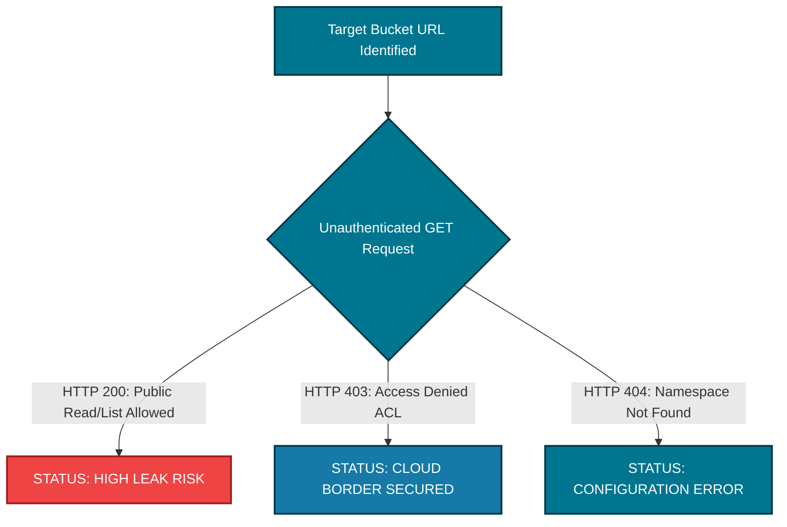

# ☁️ Cloud Bucket Leak Auditor (VaultMedia Storage Guardrail)

An enterprise-tier object storage exposure scanner designed to analyze public access control lists (ACLs) across decentralized cloud hosting servers (AWS S3 & Google Cloud Storage) holding unreleased tracking stems and media assets.

---

## 📊 Automated Cloud Exposure Mapping
Modern recording studios and creative management teams heavily rely on cloud buckets to share high-volume media files. This script isolates target object configurations and simulates unauthorized external user requests to check if data boundaries are leaking information to anonymous browsers.



---

## 🧰 Core Technical Capabilities
*   **Multi-Cloud Format Detection:** Seamlessly formats target URL endpoints based on the underlying cloud architecture rules for both AWS and GCP.
*   **Anonymous Request Emulation:** Tests real-time endpoint boundaries by sending native, unauthorized directory reads to analyze HTTP server status headers.

---

## 🚀 Execution Profile Syntax
Execute the audit script using standard terminal parameter definitions:
```bash
python3 cloud_bucket_leak_auditor.py -b [BUCKET_NAME] -p [aws/gcp]
```
